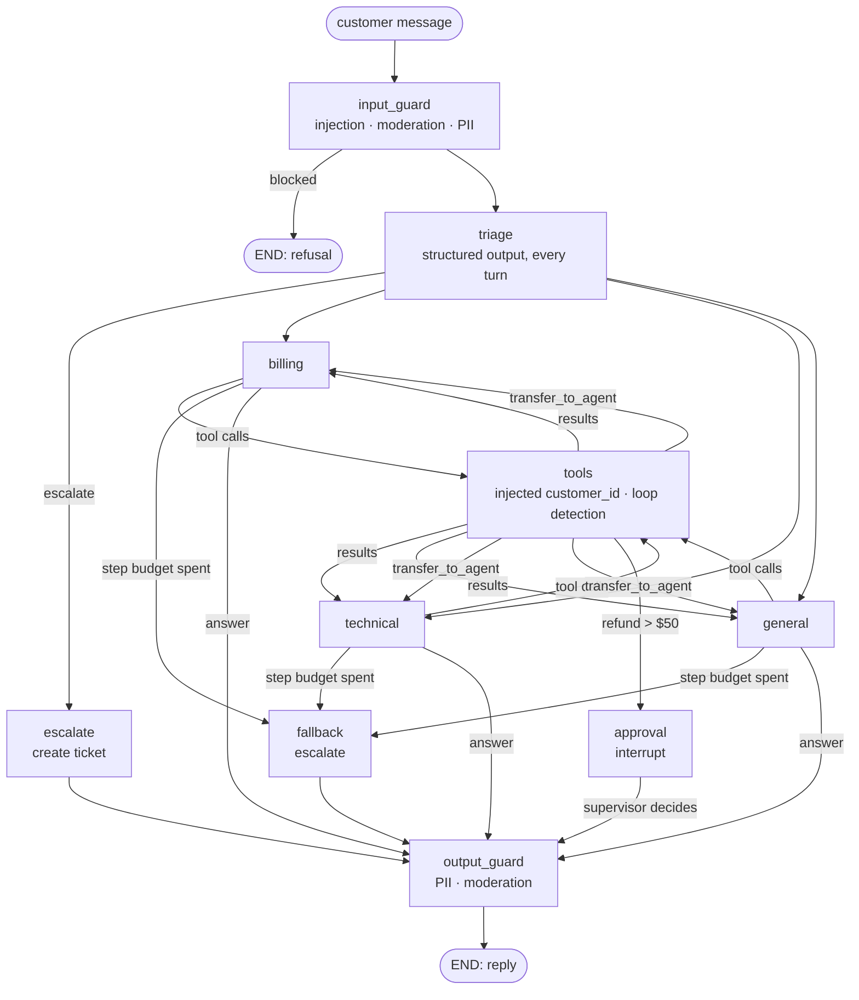
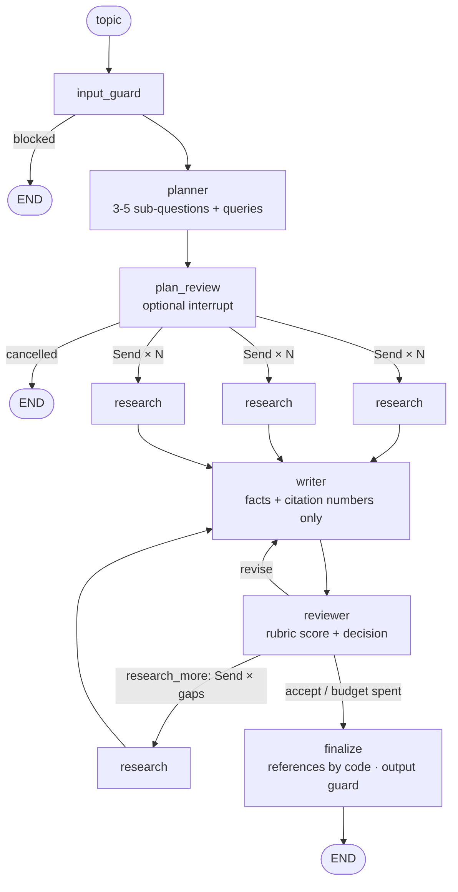
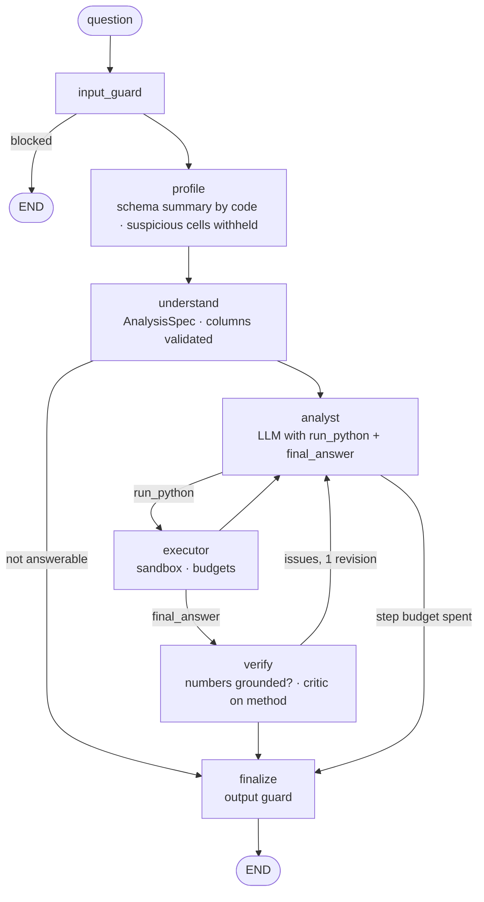

# Agent Patterns and Design Guide

This guide explains the agent design patterns in this repository, when to use each one, and the
design decisions behind them. It covers the 16 pattern modules (LangGraph and LangChain versions),
the shared guardrails, evals and tests, and three capstones that combine several patterns into
real applications: a customer support assistant, a research report generator and a data analyst.

It is written for developers who know Python and have called an LLM API before, and who want to
build agents that behave predictably. Wherever possible, the points are tied to something that
actually happened while building this repo. Several sections describe bugs we hit and what they taught us.

**Contents**

1. [Core ideas](#1-core-ideas)
2. [Choosing a pattern](#2-choosing-a-pattern)
3. [Single-agent patterns](#3-single-agent-patterns-01-02-03-11-12-14-16)
4. [Iterative patterns](#4-iterative-patterns-04-05-10-15)
5. [Multi-agent patterns](#5-multi-agent-patterns-08-09-13)
6. [State, memory and human-in-the-loop](#6-state-memory-and-human-in-the-loop-06-07)
7. [Cross-cutting design considerations](#7-cross-cutting-design-considerations)
8. [LangGraph vs LangChain](#8-langgraph-vs-langchain)
9. [Capstone: customer support assistant](#9-capstone-customer-support-assistant)
10. [Capstone: research report generator](#10-capstone-research-report-generator)
11. [Capstone: data analyst](#11-capstone-data-analyst)
12. [Lessons learned](#12-lessons-learned)

---

## 1. Core ideas

### Who owns the control flow?

Every pattern here answers one question: **who decides what happens next, the code or the model?**

| Control | Example | Predictability | Flexibility |
|---------|---------|----------------|-------------|
| Code decides everything | 11 structured output, 14 RAG | High | Low |
| Code defines the shape, model picks the branch | 03 router, 08 supervisor, 09 handoff | Medium | Medium |
| Model decides, code sets limits | 01/02 tool loops, 10 autonomous | Lower | High |

A useful default is to **give the model the narrowest control that solves the problem.** A router
that picks one of three chains is much easier to test, trace and trust than an autonomous agent
holding twenty tools. Move further down the table only when the task actually needs it.

### Three building blocks

Almost every pattern is built from the same three pieces:

- **An LLM call with structured output**, used to classify, extract, plan or judge
  (`llm.with_structured_output(PydanticModel)`). It turns a fuzzy decision into a typed value the
  code can branch on.
- **A tool loop.** The model requests tool calls (`llm.bind_tools(tools)`), the code runs them and
  sends back the results, and this repeats until the model answers in plain text.
- **State.** This is what persists between steps: messages, intermediate results, counters and flags.

The patterns differ in how these pieces are arranged.

### Graphs vs chains

- **LangGraph** models an agent as a `StateGraph`: nodes are functions that read state and return
  updates, and edges, which may be conditional, decide the next node. The framework provides
  checkpointing (pause/resume, threads), interrupts, streaming and visualization.
- **LangChain (LCEL)** composes runnables with `|` (`prompt | llm | parser`). Loops and branches
  are written in plain Python around those chains.

The same pattern can be written either way. Section 8 compares them.

---

## 2. Choosing a pattern

Start at the top and stop at the first "yes":

1. **Is the output a fixed transformation of the input?** Use a single chain or
   **structured output (11)**. No agent is needed.
2. **Does the answer depend on a known document set?** Use **RAG (14)**.
3. **Are there a few distinct kinds of request, each with its own handling?** Use a **router (03)**.
4. **Does the model need live data or actions, and decide which ones?** Use a **tool loop (01/02)**.
5. **Does output quality improve with critique?** Use **reflection (05)**, or
   **evaluator-optimizer (15)** when you have an explicit rubric.
6. **Can the task be planned up front as steps?** Use **plan-and-execute (04)**.
7. **Are there several independent sub-tasks?** Use **parallel fan-out (13)**.
8. **Do different steps need different expertise?** Use a **supervisor (08)** for a central
   coordinator, or **handoff (09)** for peer-to-peer transfer.
9. **Must a person approve something?** Add **human-in-the-loop (07)**.
10. **Must it remember across turns or sessions?** Add **memory (06)** and the **chatbot (16)** structure.
11. **Is the goal open-ended and long-running?** Use an **autonomous agent (10)**, with strict budgets.

Real applications usually combine several of these. The support capstone uses guardrails + 03 + 01 +
09 + 14 + 06 + 07. The research capstone uses 04 + 07 + 13 + 02 + 15 + 08 + guardrails. The data analyst uses 11 + 12 + 10 + 05 +
guardrails.

---

## 3. Single-agent patterns (01, 02, 03, 11, 12, 14, 16)

### 01 — Simple tool agent (hand-written tool loop)

**What it is.** The model is bound to tools. After each model response, the code checks for tool
calls, runs them, appends `ToolMessage`s and calls the model again. When there are no tool calls,
the model's text is the answer.

**Use it when** the model has to fetch data or act, and you want to see and control every step.

**Implementation.** In LangGraph, an `llm` node and a `ToolNode` are joined by a conditional edge
(`should_continue`). In LangChain, it's a `for` loop over `response.tool_calls` with `MAX_STEPS = 10`.

**Design notes**
- **Write tool docstrings carefully.** The docstring is the tool's documentation for the model.
  `calculate` says "simple arithmetic expression (e.g. '42 * 7')", and the example is what gets the
  model to pass a clean expression.
- **Constrain tools that evaluate input.** `calculate` allows only digits and operators before
  calling `eval`. Never `eval` model output without restrictions like this.
- **Tool queries matter as much as prompts.** `get_weather` originally searched "current weather in
  {city}", which returned monthly climate averages. Searching "{city} weather today temperature"
  over the past day (`time_range="day"`) returns today's conditions. The eval suite caught this (section 10).
- **Failure mode: endless tool calls.** The LangChain loop is capped. The LangGraph version
  relies on the model eventually answering, which is acceptable for a demo but not for production
  (section 7.1).

### 02 — ReAct agent

**What it is.** The same loop as 01, framed as Reason → Act → Observe. The LangGraph version uses
the prebuilt `create_react_agent`. The LangChain version is `ChatPromptTemplate | llm.bind_tools`
plus a loop.

**Use it when** you want a general-purpose assistant with a handful of tools and don't need custom control flow.

**Design notes**
- **The prebuilt helper is deprecated.** `create_react_agent` is deprecated in LangGraph 1.2. In
  LangChain 1.x its successor `create_agent` is itself built on LangGraph, so the LangChain version
  here uses only `langchain-core` primitives.
- **One search service, three tools.** All three tools use Tavily, steered by `topic`: `"finance"`
  for prices, `"news"` with `time_range="week"` for headlines. Narrow tools with clear names are
  easier for the model to choose between than one generic "search" tool.
- **Live data varies.** The eval for "current MSFT price" sometimes gets a dated answer from the
  search results. Graders need to know today's date to judge this (section 7.9).

### 03 — Router

**What it is.** A classifier with structured output (`RouteDecision`: math, writing or general)
picks which specialist prompt answers the query. In LangGraph this is `add_conditional_edges`. In
LangChain it's `RunnablePassthrough.assign(route=classifier)`, followed by a `RunnableLambda` that
returns the chosen chain.

**Use it when** requests fall into a few distinct categories that need different prompts, tools or
models. Routing easy queries to cheaper chains is also a common cost saving.

**Design notes**
- **Use `Literal` route values** so the classifier can only return valid branches. A free-text
  route needs extra validation.
- **Keep the classifier prompt short, with examples of each category.** Ambiguous categories lead
  to inconsistent routing.
- **Evaluate routing on its own** (`fields: {"route": "math"}`), separately from answer quality. A
  good answer from the wrong specialist hides a routing bug.
- **In a conversation, route every turn, not just the first** (see the capstone, section 9.4).

### 11 — Structured output

**What it is.** A single call, `prompt | llm.with_structured_output(EmailAnalysis)`, turns an
email into a validated Pydantic object with nested models, optional fields and defaults.
`.batch()` processes several emails concurrently.

**Use it when** downstream code needs typed fields rather than prose: extraction, form filling,
classification, or tagging data for pipelines.

**Design notes**
- **Field descriptions are prompts.** `Field(description=...)` tells the model what each field means.
- **Make fields optional when they may be missing** (`Optional[str] = None`), and tell the model to
  use null. Otherwise it invents values to satisfy the schema.
- **Validation is free.** Pydantic rejects malformed output, and defaults
  (`default_factory=list`) give consistent shapes.
- **This agent needs PII.** Extracting contact details is its job, so the UI turns off PII
  redaction for it (`PII_EXEMPT`). Guardrail policy has to be set per agent (section 7.6).

### 12 — Code execution

**What it is.** The model writes Python and calls `execute_python`. The code is checked against an
AST blocklist, run in a subprocess with a 10-second timeout, and its output is fed back so the
model can interpret the result or fix errors.

**Use it when** answers need exact computation, such as data analysis or maths, where generated
text is unreliable.

**Design notes**
- **The AST filter is a demo safeguard, not a sandbox.** The data analyst capstone tightens it
  (section 11.3): an import allow-list instead of a blocklist, no dunder access, isolated mode and
  a stripped environment. It's still not a security boundary. It blocks imports of `os`, `subprocess`,
  `socket` and similar, plus calls like `eval`, `exec`, `open` and `getattr`. A determined attacker
  can get around static filters. In production, run code in a container, a microVM or a hosted
  interpreter, with CPU, memory, network and filesystem limits.
- **Cap the number of executions** (`execution_count < 5`). A model can keep "fixing" code forever.
- **Return stderr to the model.** Error messages are what let it correct its code.

### 14 — RAG (retrieval-augmented generation)

**What it is.** The query is embedded and the k most similar documents are retrieved from FAISS,
then the model answers using **only** that context. In LangChain this is the classic
`RunnablePassthrough.assign(retrieved_docs=retriever).assign(answer=...)` chain.

**Use it when** answers must come from a known corpus, such as internal docs, policies or product data.

**Design notes**
- **Tell the model to refuse when the context doesn't cover the question.** The eval asks "What is
  the boiling point of water?", which the knowledge base doesn't cover, and passes only if the
  agent declines. That checks grounding, not general knowledge.
- **Return the retrieved documents with the answer.** It allows citations, debugging ("was the
  right document retrieved?") and evaluation of retrieval separately from generation.
- **`k` is a trade-off.** Too few documents miss context; too many dilute it and cost tokens.
- **Build the index lazily** (`_vectorstore is None`), so importing the module doesn't make an API call.
- **Production:** replace in-memory FAISS with a persistent vector DB, add chunking, metadata
  filters and re-ranking.

### 16 — Chatbot

**What it is.** The simplest stateful agent: a system prompt plus conversation history, keyed by
`thread_id` (LangGraph `MemorySaver`) or `session_id` (LangChain `RunnableWithMessageHistory`).

**Use it when** you're starting a conversational product. Add tools, retrieval or routing to this core.

**Design notes**
- **Thread identity is a product decision.** One thread per browser tab? Per user? Per ticket?
  Each choice changes what the bot remembers.
- **History grows without limit.** Long conversations need trimming or summarization before they
  exceed the context window or get expensive.
- **Deprecation:** LangChain now marks `RunnableWithMessageHistory` as deprecated in favour of
  LangGraph persistence. It still works, but expect it to be removed in LangChain 2.0.

---

## 4. Iterative patterns (04, 05, 10, 15)

All four loop until a condition is met. **Every one of them needs an explicit limit**: the most
important lesson in this repo (section 7.1).

### 04 — Plan-and-execute

**What it is.** A planner produces 3–5 steps. An executor runs each step with the results so far.
A replanner either produces the final answer or revises the remaining steps.

**Use it when** a task benefits from a visible plan, for example research or multi-step analysis,
and you want to inspect or adjust it.

**Design notes**
- **Budget the loop.** After `MAX_STEPS = 10` executed steps, the replanner is told the budget is
  used up and must answer. If it still doesn't, the step results become the answer. Without this,
  the LangGraph version ran for more than 7 minutes (section 10).
- **Handle an empty plan.** If the replanner returns no steps, finish with what you have rather
  than crashing (LangGraph) or returning no answer (LangChain). Both bugs existed and were found by tests.
- **Watch what the replanner sees.** Step results are truncated to 200 characters, so the replanner
  rarely decides the work is complete and usually uses the full budget. Passing fuller results
  would cut cost and latency.

### 05 — Reflection

**What it is.** A generator writes a draft, and a critic (structured output: approved, score,
feedback) reviews it. The loop repeats with the feedback until the critic approves or
`max_iterations` is reached.

**Use it when** quality improves with critique, as with writing or code review, and the critic can
judge it reliably.

**Design notes**
- **Use separate models or temperatures.** The generator uses temperature 0.7 for variety and the
  critic uses 0 for consistency.
- **Make feedback actionable.** The critic must return "specific, actionable feedback", which the
  generator receives verbatim along with its previous draft.
- **Mind the cost.** Each iteration is two LLM calls, so in practice 2–3 iterations is usually enough.

### 15 — Evaluator-optimizer

**What it is.** Reflection with an explicit **rubric** (five 0–2 criteria, so a score out of 10)
and a pass threshold. It also records the score history.

**Use it when** you can write down what "good" means. A rubric gives more consistent scores than
an open-ended critique, and the score history shows whether revisions are actually helping.

**Design notes**
- **Write the rubric as dimensions.** Clarity, benefit focus, specificity, emotional appeal and a
  call to action. Each one tells the generator what to fix.
- **Flat score histories are a signal.** If scores stop improving, more iterations only add cost.

### 10 — Autonomous agent

**What it is.** The model receives a goal and tools (research, save note, generate report, mark
complete) and decides every step itself. Progress notes are fed back into its prompt.

**Use it when** the goal is open-ended and you're willing to trade predictability for flexibility.
Background research is the typical case.

**Design notes**
- **Make "done" explicit and checkable.** The agent must call `mark_goal_complete`. Code, not the
  model, decides the loop is over.
- **Budget everything:** iterations (`max_iterations`), and in production also tokens, money and wall-clock time.
- **Show progress.** Feeding saved notes back into the system prompt keeps the agent from repeating work.
- **This is the hardest pattern to evaluate.** Its paths vary from run to run, so the eval checks
  outcomes (required tools used, at least one note saved, within budget) rather than exact steps.

---

## 5. Multi-agent patterns (08, 09, 13)

### 08 — Supervisor

**What it is.** A supervisor with structured output (`RoutingDecision`: researcher, writer or
FINISH) chooses the next worker based on a status summary. Workers do their job and report back.

**Use it when** a task has distinct roles that run in an order a coordinator can reason about.

**Design notes**
- **The supervisor sees a summary, not everything.** It gets "Research complete: …first 100
  chars…", which keeps its prompt small and its decisions focused.
- **State the routing rules** ("never route to a worker that has already completed its work"), and
  **cap worker calls** (6) in case it ignores them.
- **Versus a fixed pipeline:** if the order is always research → write, a plain sequence is
  simpler and cheaper. A supervisor earns its cost when the order varies.

### 09 — Handoff (swarm)

**What it is.** Peer agents (triage, billing, technical) transfer the conversation by replying
`HANDOFF:<agent>`. LangGraph nodes return `Command(goto=target)`. The LangChain version loops over
the active agent's chain.

**Use it when** you have specialists with clear domains and no need for a central coordinator.

**Design notes**
- **Cap handoffs.** Two agents that each believe the issue belongs to the other will bounce it
  back and forth forever. The LangGraph version had no cap and looped about 10,000 times until
  LangGraph's recursion limit (section 10). Both versions now stop at `MAX_HANDOFFS = 3`.
- **Parse handoffs strictly.** A regex anchored at the start (`^HANDOFF\s*:\s*(\w+)`) and a
  whitelist of valid agents keep the model from inventing destinations.
- **Prefer tool calls to magic strings in real systems.** The capstone uses a
  `transfer_to_agent(agent: Literal[...])` tool, which is schema-checked.

### 13 — Parallel fan-out (map-reduce)

**What it is.** The same analysis runs concurrently for each item, then a synthesizer combines the
results. LangGraph uses `Send()` per item with an `operator.add` reducer collecting results.
LangChain uses `chain.batch(items, max_concurrency=8)`.

**Use it when** sub-tasks are independent: comparing options, analysing many documents, or
researching several angles.

**Design notes**
- **Reducers matter.** Parallel branches writing to the same state key need a reducer
  (`Annotated[List[str], operator.add]`), or results overwrite each other.
- **Limit concurrency.** Provider rate limits are real; `max_concurrency` keeps bursts under control.
- **Tag each result with its item** (`[Rust] …`) so the reducer and the evals can tell them apart.

---

## 6. State, memory and human-in-the-loop (06, 07)

### 06 — Memory

**What it is.** Two kinds of memory:
- **Short-term:** this conversation's messages, stored by the checkpointer and keyed by `thread_id`.
- **Long-term:** facts about the user across conversations, kept in a store
  (`InMemoryStore`, namespace `("user_facts", user_id)`), or in a dict in the LangChain version.

**Use it when** the agent should remember the user, not just the current chat.

**Design notes**
- **Know which memory you need.** A new thread clears short-term memory, while long-term facts
  should survive. The eval asks "Do you remember my name?" in a *new* thread to test exactly that.
- **Decide how facts are extracted.** This demo uses regexes ("my name is X") for transparency.
  Production systems usually have an LLM summarize facts, plus rules about what may be stored.
- **The store must be annotated as `BaseStore` exactly.** LangGraph 1.2 only injects the store into
  a node if the parameter is typed `store: BaseStore`. With `store: InMemoryStore`, every call
  failed with "missing 1 required keyword-only argument: 'store'" (section 10).
- **Persistence:** `MemorySaver` and `InMemoryStore` disappear when the process restarts. Use
  `SqliteSaver` for a single machine, or Postgres-backed savers and stores for production.
- **Privacy:** long-term memory is personal data. Decide what to keep, for how long, and how users can delete it.

### 07 — Human-in-the-loop

**What it is.** The agent proposes an action and **pauses** until a person approves or rejects it.
- **LangGraph:** `interrupt(payload)` stops the graph and the checkpointer saves its state. Later,
  `invoke(Command(resume=decision), config)` continues from the same node.
- **LangChain:** two separate calls, `propose_action()` then `resolve()`. The application holds the
  pending state in between.

**Use it when** an action is costly, irreversible or regulated: payments, deletions, outbound
messages, account changes.

**Design notes**
- **Resumed nodes re-run from the top.** When the graph resumes, LangGraph executes the
  interrupted node again from the beginning, and `interrupt()` returns the decision this time. So
  **put side effects after `interrupt()`, never before it**, or they happen twice.
- **Check conditions again when resuming.** Time passes between the pause and the decision. The
  capstone re-checks the refund policy after approval, and a test proves an order refunded in the
  meantime is not refunded twice.
- **Decide what new input does while paused.** Invoking the graph with a new message during an
  interrupt starts a new run and drops the pending one. The capstone holds the conversation instead.
- **LangGraph's advantage:** the paused state lives in the checkpointer, so it survives restarts
  and can be resumed by another process. The LangChain version keeps the pending action in
  application memory.

---

## 7. Cross-cutting design considerations

### 7.1 Every loop needs a budget

Any loop that the model can keep going will, sooner or later, keep going: tool calls, replans,
handoffs, retries. **LangGraph 1.2 raised the default `recursion_limit` to about 10,000 steps**
(older versions used 25), so the framework is no longer a practical safety net.

| Loop | Limit in this repo |
|------|--------------------|
| Tool loop (LangChain 01/02) | `MAX_STEPS = 10` |
| Code execution (12) | 5 executions |
| Plan-and-execute (04) | 10 steps, then a forced answer |
| Handoff (09) | 3 handoffs |
| Supervisor (08) | 6 worker calls |
| Autonomous (10) | `max_iterations` |
| Capstone specialists | 8 LLM calls per message, then escalate; 2 transfers per message |

Two more techniques help:

- **Loop detection.** The capstone notices when the model repeats an identical tool call within a
  turn and tells it to answer, transfer or escalate instead.
- **Degrade gracefully.** When a budget runs out, give the best answer available or hand off to a
  human. Don't crash, and don't return nothing.

There is a test for every cap (`test_*_capped`, `test_09_handoff_ping_pong_terminates`,
`test_step_budget_escalates_instead_of_looping`). Two of those tests found real bugs on their
first run.

### 7.2 State design

- **Keep state minimal and typed** (`TypedDict` or Pydantic). Every field is something a node can
  get wrong.
- **Use reducers on purpose.** `add_messages` appends, and replaces any message with the same
  `id`. The capstone uses this to swap a customer message for its redacted version. Use
  `operator.add` for parallel results; anything else is overwritten.
- **Reset per-turn counters.** The capstone resets `steps` and `handoffs` on every customer
  message. Otherwise one long turn would use up the budget for the whole conversation.
- **Thread state vs store.** The conversation lives in the checkpointer, keyed by thread.
  Knowledge about a user lives in the store, keyed by namespace. Mixing them up means either
  forgetting things that should be remembered, or leaking them between users.

### 7.3 Tool design

- **Narrow tools, clear names, precise docstrings.** The model chooses tools from their name and
  docstring alone.
- **Never let the model choose whose data it accesses.** The capstone's tools take
  `customer_id: Annotated[str, InjectedToolArg]`. It is hidden from the tool schema the model sees
  and filled in from the session. A test checks that even if the model *adds* a `customer_id`
  argument, the session's customer is used.
- **Enforce authorization in the backend, not the prompt.** `data.get_order(order_id, customer_id)`
  returns nothing for another customer's order. "Only discuss this customer's orders" in a prompt is
  just a request; the backend check is the actual protection.
- **Return structured outcomes for actions.** `request_refund` returns JSON
  (`issued`, `needs_approval` or `denied`) so the graph can act on the result. The model only relays the message.
- **Mock external systems behind the same interface.** All tools here except Tavily are mocked
  (`data.py`), so demos, tests and evals are free and repeatable.

### 7.4 Business rules belong in code

The model should decide **what the customer is asking for**. Code should decide **what is
allowed**. In the capstone, `policies.refund_verdict()` applies the 30-day window, the delivery
status and the $50 approval limit as plain Python:

- it's deterministic: the same order always gets the same answer;
- it's testable, including the day-30 vs day-31 boundary;
- it can't be argued out of. A customer can't persuade a Python function, and a prompt-injected
  model can't skip the check.

### 7.5 Structured output as a control surface

Structured output turns model judgement into typed values the code can branch on: routes,
verdicts, scores, plans. Use `Literal` for choices, `Field(description=...)` for meaning,
`Optional` for missing data, and validation bounds (`ge=1, le=10`) for scores.

### 7.6 Guardrails

`guardrails.py` is a shared layer around agents. It is **defence in depth**, not a single filter:

| Stage | Check | Action |
|-------|-------|--------|
| Input | Empty or too long | Block |
| Input | Prompt injection: regex, plus an optional LLM classifier for reworded attacks | Block |
| Input | OpenAI moderation | Block |
| Input + output | PII: email, phone, card numbers (Luhn-checked), SSN, IP addresses | Redact |
| Output | Moderation | Block |

**Design notes**
- **Order the checks cheapest first.** Length, then regex injection checks (free), then the
  moderation API, then redaction. A blocked input never reaches the paid checks.
- **Expect false positives.** An early card-number regex matched Fibonacci output
  (`0 1 1 2 3 5 8 13 21 34`). The fix was to require real card layouts and a Luhn checksum, and
  the tests now include known false positives that must not be redacted.
- **Fail open or closed?** If the moderation API is down, `fail_open=True` logs a warning and
  continues. Fail closed for high-risk applications.
- **Some agents need exemptions.** Agent 11 extracts contact details, so PII redaction would break
  it. Make the policy configurable per agent.
- **Direct vs indirect injection.** `Guard` checks **user** input. Web pages returned by Tavily can
  also contain instructions ("ignore previous instructions…"), which is *indirect* injection. The
  research capstone handles this by scanning every search result and dropping any that contain
  injection patterns *before* the model sees them. It also tells the model that source text is
  untrusted, and only passes the writer the extracted facts, never raw web text (section 10.3).
  The pattern modules 01, 02 and 10 don't do this yet.
- **Regexes are a first layer only.** They catch the obvious attacks cheaply. The LLM classifier
  catches paraphrases at the cost of one extra call per message.

### 7.7 Retrieval and grounding

- Evaluate retrieval and generation separately: was the right document retrieved, and was the
  answer faithful to it?
- Keep document titles and sources in metadata, so answers can cite them
  (`[Refund policy] …` in the capstone).
- Test the "not in the knowledge base" case. It's the cheapest way to catch hallucination.
- **Being grounded is not the same as being true.** Grounding checks only that claims match the
  sources. In the first real research report, one claim (lithium-ion batteries "last two years")
  was faithfully copied from a low-quality web page. Source quality needs its own defence:
  domain allow-lists, preferring primary sources, or asking for two independent sources per key claim.

### 7.8 Testing strategy: unit tests vs evals

These answer different questions, and you need both:

| | Unit tests (`tests/`) | Evals (`evals/`, capstone `evals.py`) |
|---|---|---|
| Question | Is the code wired correctly? | Is the model's output good enough? |
| LLM | Scripted fake | Real model |
| Cost and time | Free, about 30 seconds | Costs API credit, about 10 minutes |
| Determinism | Fully deterministic | Varies between runs |
| Runs | Every push (CI) | On demand or nightly |
| Catches | Missing loop limits, broken wiring, guardrail regex bugs | Bad routing, weak answers, poor tool data |

**The fake LLM.** `tests/fakes.py` defines `FakeChat`, a real `BaseChatModel`, so prompts,
`bind_tools`, structured output, `ToolNode` and graphs all run their real code. Only the model's
replies are scripted (`script.structured[...]`, `script.reply`, `script.tool_calls`). This found
three bugs that real-API runs had missed.

### 7.9 Evaluating with an LLM judge

The judge checks open-ended criteria such as "explains that Send() fans out in parallel". Two
judge bugs were found in this repo:

- **The judge doesn't know today's date.** It called an October 2026 stock price "a future date".
  Put today's date in the judge prompt.
- **The judge uses its own knowledge.** It marked the RAG agent down for correctly declining to
  answer, because the judge knew the boiling point of water. State the expected behaviour
  explicitly in the criteria ("the CORRECT behaviour is to decline…"), and add simple checks the
  judge can't override (`must_not_contain: ["100", "212"]`).

**Practices**
- **Prefer simple checks** (`must_contain`, `fields`, `must_use_tools`, numeric bounds) and use the
  judge only for what they can't check.
- **Version datasets by content.** Each suite gets a LangSmith dataset named
  `aiagents-<suite>-<hash>`, so editing a case creates a new dataset instead of silently changing
  the old one. That keeps experiments comparable.
- **Don't relax a failing case without understanding it.** The Tokyo weather case still fails
  because Tavily's results for Tokyo were poor. That is a true signal about the tool.
- **Evaluate outcomes, not exact paths.** The capstone's evals check "was A-1002 refunded after
  approval?", not which exact sequence of calls produced it.

### 7.10 Observability

- **Turn tracing on in development.** With `LANGCHAIN_TRACING_V2=true`, every node, LLM call and
  tool call goes to LangSmith.
- **Keep tests from leaking traces.** Agents call `load_dotenv()`, which re-adds a deleted
  `LANGCHAIN_API_KEY` from `.env`. Tests therefore set the key to an empty string, which
  `load_dotenv` never overwrites. Separately, `evaluate(upload_results=False)` still sets tracing
  to "local", which nested LangChain calls treat as enabled. Local evals disable tracing explicitly.

### 7.11 Cost and latency

- Every loop iteration and judge check is another LLM call, so budgets are also cost controls.
- Use cheaper models for classification (routing, triage, injection checks), and keep stronger
  ones for generation where quality matters.
- Long-running patterns (04, 08, 10) benefit from streaming progress to the UI. A spinner for 30
  seconds feels broken.
- Track token usage per run. The model responses include `usage_metadata`.

### 7.12 Security checklist

- **Network exposure.** `streamlit run` listens on every network interface by default, and the
  first launch here printed a public "External URL". Anyone who can reach it can spend your API
  credit and use the code-execution agents. This repo's `.streamlit/config.toml` (and `start.bat`)
  bind the server to `localhost`, and `tests/test_main_app.py` keeps it that way. If the app must
  be shared, put it behind authentication rather than opening the port.
- **Code execution** needs a real sandbox in production (see 12).
- **Secrets** live in `.env`, which is gitignored. CI evals use repository secrets and run only on manual dispatch.
- **Authorization** goes in tools and the backend, not prompts (7.3).
- **Untrusted content:** both user input and tool output (7.6).

### 7.13 Dependency management

Two runtime bugs came from LangGraph minor versions changing behaviour: store injection
annotations and the default recursion limit. `requirements.txt` therefore pins exact versions. To
upgrade: bump the version, run `pytest`, then run the evals.

---

## 8. LangGraph vs LangChain

Each pattern exists in both frameworks, with the same prompts and demos, so you can compare them directly.

| Need | LangGraph | LangChain (LCEL + Python) |
|------|-----------|---------------------------|
| Linear chain | Graph with one or two nodes (more ceremony) | `prompt \| llm \| parser`, the natural fit |
| Loops and branches | Conditional edges, visible in the graph | `while`/`if` in Python, which is simple but hidden in code |
| Parallel fan-out | `Send()` + reducers | `.batch()` |
| Pause/resume (HITL) | `interrupt()`; state survives restarts | Split into two calls; the app holds state |
| Conversation memory | Checkpointer keyed by thread | `RunnableWithMessageHistory` (deprecated) |
| Long-term memory | Store, injected into nodes | Your own dict or database |
| Streaming intermediate steps | Built in | Manual |
| Tracing | Every node, automatically | Every runnable, automatically |
| Learning curve | Higher | Lower |

**How to choose**
- **LangChain** suits short, linear or simply looping flows: extraction, RAG, routing, map-reduce.
  The LangChain modules here are usually shorter.
- **LangGraph** suits durable, resumable state: human approval, long-running agents, multi-agent
  handoffs, or anything that must survive a restart. That's why the capstone uses LangGraph.
- **Mixing works.** LCEL chains run fine inside LangGraph nodes.

The repo keeps the two apart on purpose. The `langchain/` modules never import `langgraph`, and a
test enforces it, because LangChain 1.x's `create_agent` is itself built on LangGraph.

---

## 9. Capstone: customer support assistant

`projects/customer_support/` combines seven patterns into a support assistant for a fictional store.
Run it with `streamlit run projects/customer_support/ui.py` (customer chat plus supervisor console)
or `python -m projects.customer_support.demo`.

### 9.1 Architecture

| Pattern | In the capstone |
|---------|-----------------|
| Guardrails | `input_guard`, `output_guard` |
| Router (03) | `triage` → billing, technical, general or escalate |
| Tool loop (01) | Each specialist ↔ `tools`, capped at 8 LLM calls per message |
| Handoff (09) | `transfer_to_agent` tool, capped at 2 per message |
| RAG (14) | `search_help_center` over 9 help-centre articles, with citations |
| Memory (06) | Checkpointer per conversation; long-term case notes per customer in the store |
| Human-in-the-loop (07) | `approval` node with `interrupt()` for refunds over $50 |

### 9.2 Walkthrough: a $329 refund

1. **"Please refund my monitor, order A-1002."** `input_guard` finds nothing to block or redact.
2. `triage` classifies the message as `billing`, and the billing specialist calls
   `request_refund(order_id="A-1002", reason="dead pixels")`.
3. The `tools` node adds `customer_id="C001"` from the session.
   `policies.refund_verdict` returns `needs_approval`: the order was delivered 10 days ago and the
   amount is over $50.
4. `tools` posts a holding message ("a supervisor needs to approve it…") and routes to `approval`.
5. `approval` calls `interrupt({...refund details...})`. The graph stops, and the checkpointer
   holds the state. The UI shows the request in the supervisor console and disables the customer's
   chat input.
6. The supervisor clicks **Approve**, which calls `SupportSession.decide(True)`, which calls
   `invoke(Command(resume={"approved": True}))`.
7. `approval` runs again from the top. This time `interrupt()` returns the decision. The node
   re-checks the policy, issues the refund, saves a case note ("Refunded A-1002 … after supervisor
   approval") and replies.
8. `output_guard` checks the reply and the turn ends. In a later conversation, the billing agent's
   prompt includes that case note, so "Did my refund go through?" can be answered without a tool call.

### 9.3 Key design decisions

| Decision | Why |
|----------|-----|
| `customer_id` is injected, never chosen by the model | The model can't ask for another customer's data, even under prompt injection. Tested with a model that tries. |
| Refund rules in `policies.py` | Deterministic, testable at the day-30/31 boundary, and impossible to talk around. |
| Approval threshold ($50) | Small refunds go through instantly; large ones get human oversight. A common real-world split. |
| Policy re-checked after approval | The order may have changed while waiting. Tested to make sure nothing is refunded twice. |
| Side effects only after `interrupt()` | The node re-runs on resume, so anything before `interrupt()` would happen twice. |
| Holding message, then chat locked while paused | The customer knows what's happening, and new input can't drop the paused approval. |
| Triage on every message | See 9.4. |
| Loop detection plus a step budget, then escalate | A stuck agent hands off to a human instead of looping. |
| Long-term case notes per customer | Continuity across conversations without replaying old transcripts. |
| A fresh graph per eval scenario, with backend reset | Scenarios are independent and repeatable. |

### 9.4 What the first demo run taught us

The first version routed only the **first** message and kept that specialist for the rest of the
conversation. In the first real demo:

1. "What are your phone hours?" went to the general agent, which was correct.
2. "I'd like a refund for my earbuds" stayed with the general agent, which has no refund tool.
3. Instead of transferring, it called `get_order` **eight times in a row**, until the step budget
   escalated to a human.

The budget prevented a runaway, but the design was wrong. There were two fixes:

- **Triage runs on every message**, using a short plain-text transcript, so the conversation
  follows the topic.
- **Loop detection** tells the model, after a repeated identical call, to answer, transfer or escalate.

After the fixes, the same conversation routed the refund to billing on the first try. The lesson:
"route once" works for single requests, while conversations change topic.

### 9.5 Evals and tests

- **11 scenario evals** (`python -m projects.customer_support.evals`) check outcomes:
  - the FAQ answer is grounded in the help centre;
  - order tracking works;
  - the automatic refund is issued;
  - the large refund is approved, and in another case rejected;
  - the out-of-window refund is declined, with the warranty mentioned;
  - **another customer's order reveals nothing**;
  - the login-error fix comes from the help centre;
  - "talk to a manager" escalates;
  - injection is blocked;
  - a conversation that switches topic mid-way is handled.

  All 11 passed against the real API.
- **25 offline tests** (`tests/test_support.py`) cover the policy boundaries, tool authorization,
  every routing and approval path, loop limits, guardrails, memory, and the UI's approval flow.

### 9.6 Extending it

- **Persistence:** swap `MemorySaver` and `InMemoryStore` for SQLite or Postgres versions, so
  pending approvals survive restarts.
- **Real backend:** replace `data.py` with API clients and keep the same function signatures.
- **Indirect injection:** run guardrails on tool outputs as well (7.6).

---

## 10. Capstone: research report generator

`projects/research_report/` turns a topic into a cited Markdown report. Run it with
`streamlit run projects/research_report/ui.py` (live progress, plan review, cost) or
`python -m projects.research_report.demo "topic"`.

### 10.1 Architecture

| Pattern | In the capstone |
|---------|-----------------|
| Plan-and-execute (04) | `planner` with structured output (`ResearchPlan`), capped at 5 questions |
| Human-in-the-loop (07) | `plan_review` interrupt: approve, edit or cancel before any research is paid for |
| Parallel fan-out (13) | `Send("research", …)` per question; `findings` uses an `operator.add` reducer |
| Tools (02) | Tavily search in each researcher |
| Evaluator-optimizer (15) | `reviewer` scores against a 10-point rubric; `writer` revises with the feedback |
| Supervisor (08) | The reviewer decides accept, revise or research more; code enforces the budgets |
| Guardrails | Topic input guard, untrusted-source filter, output guard on the final report |

### 10.2 How a report is produced

1. **Plan.** The planner returns 3–5 sub-questions, each with its own search query. If plan
   review is on, the graph pauses and the user can edit the list or cancel. **No search or
   extraction cost has been spent yet**, so this is the cheapest moment for a person to correct
   the direction.
2. **Research in parallel.** `plan_review` returns `Command(goto=[Send("research", q) for q in plan])`.
   Each researcher receives only its own question, searches Tavily, drops untrusted results, and
   extracts 3–6 facts, each tied to a source number. A reducer merges the findings, and the writer
   runs once **all** researchers are done (fan-in).
3. **Write.** Code numbers every source once across all findings and gives the writer facts like
   `- Samsung targets mass production by 2027 [5]`. The writer cites those numbers and never sees
   a URL.
4. **Review.** The reviewer scores the draft (coverage 3, grounding 3, clarity 2, balance 2) and
   chooses `accept`, `revise` or `research_more`. Code also checks that every `[n]` in the draft
   matches a real source. A draft with a broken citation is **not accepted, even at 9/10**.
5. **Loop within budgets.** At most one follow-up research round (up to 2 gap questions) and 2
   revisions. When the budget is spent, the best draft is finalized rather than failing.
6. **Finalize.** Code appends the References section from the source list, and the output guard
   checks the whole report.

### 10.3 Key design decisions

| Decision | Why |
|----------|-----|
| Citations numbered and listed by code | Models invent or garble URLs and numbering. Here the model only repeats numbers it was given, and code validates them. |
| Writer sees extracted facts, not web pages | Keeps the prompt small, ties every claim to a source, and keeps raw (possibly malicious) web text away from the writing step. |
| Untrusted web results filtered before extraction | Defends against indirect prompt injection. Dropped sources are reported, not hidden. |
| Researchers receive only their own question | Each `Send` payload is small and independent, so it parallelizes cleanly, and one failed search affects one section only. |
| Plan review before research | People correct direction where it's cheapest. Editing questions costs nothing; researching the wrong ones costs money. |
| Reviewer decides, code enforces | The model judges quality; code caps rounds and revisions and adds the deterministic citation check. |
| Best-effort finish when budgets run out | A report with known gaps beats an endless loop or an error. |
| Token usage tracked per run | `get_usage_metadata_callback()` collects tokens per model, and the UI shows an estimated cost. |
| Progress streamed | `graph.stream(stream_mode="updates")` shows each node as it finishes, so 30–60 seconds of work doesn't look frozen. |

### 10.4 Results and tests

- **The first real run:** 5 questions researched in parallel, 18 de-duplicated sources, accepted at
  9/10 on the first review. About 11.6k tokens, roughly $0.003.
- **5 scenario evals** (`python -m projects.research_report.evals`): three full reports checked for
  structure, citation integrity, budgets and a judged balance criterion, plus an approved plan
  review, a cancelled plan review (no research run), and a blocked injection topic. All passed
  against the real API.
- **16 offline tests** (`tests/test_research.py`) cover:
  - the parallel fan-out, and the cap on plan size;
  - the revise loop and the follow-up research round, both hitting their budgets;
  - broken citations blocking acceptance;
  - **injected web pages never reaching the model**;
  - facts that cite non-existent sources being dropped;
  - a search failure still producing a report;
  - plan review approving, editing and cancelling;
  - the UI flow.

---

## 11. Capstone: data analyst

`projects/data_analyst/` answers questions about a CSV by writing and running pandas code, then
verifies its own answer. Run it with `streamlit run projects/data_analyst/ui.py` (upload a CSV,
ask questions, see charts and the code) or `python -m projects.data_analyst.demo`.

### 11.1 Architecture

| Pattern | In the capstone |
|---------|-----------------|
| Structured output (11) | `understand` → `AnalysisSpec` (intent, metrics, dimensions, filters, chart?, answerable?) |
| Code execution (12) | `sandbox.py`, with stricter rules than module 12 |
| Autonomous loop (10) | `analyst` ⇄ `executor` until `final_answer`, capped at 6 runs and 10 steps |
| Reflection (05) | `verify`: deterministic number grounding plus an LLM critic, one revision |
| Guardrails | Question guard, untrusted-cell filter in `profile`, output guard |

### 11.2 How a question is answered

1. **Profile (code, no LLM).** Column names, types, ranges and a few sample values. Cell values
   come from a user's file, so any that look like prompt injection are withheld and reported.
2. **Understand.** Structured output turns the question into a plan. **Code then checks it against
   the real columns**: invented column names are dropped. If the data can't answer the question
   (for example, "customer satisfaction" with no such column), it says so and lists what the data
   does contain. No code runs and no money is spent.
3. **Analyse.** The model writes code, the sandbox runs it, and the output goes back to the model.
   It repeats until the model calls `final_answer`. Charts are saved with a `save_chart()` helper.
4. **Verify.** Two independent checks:
   - **Number grounding (code):** every figure in the answer must match a number the code actually
     printed, allowing for formatting (`$744,832`, `$744.8K`, `28.8%` vs a printed `0.2876`).
     Years, dates and small counts are skipped. Any figure that matches nothing is treated as
     invented.
   - **Method review (LLM):** right columns, filters, aggregation and time period?

   Either check can send the analyst back once, with specific feedback. If problems remain after
   that, the answer is flagged `answered_with_concerns` and starts with the reviewer's concerns.
5. **Finalize.** The output guard runs, and the UI shows the answer, the charts, a verification
   badge, and every code run with its output ("show your work").

### 11.3 Key design decisions

| Decision | Why |
|----------|-----|
| Verify numbers against execution output | The worst analyst failure is a confident, invented number. A regex-and-tolerance check catches it every time, at no cost. |
| An LLM critic for the method | Grounding proves a number was computed, not that it was the *right* computation (sum vs mean, wrong filter). |
| Code validates the plan's columns | Models invent plausible column names. Checking against the real schema is free and certain. |
| "Unanswerable" detected before any code runs | Saves cost, and avoids a misleading answer built from the wrong columns. |
| Import allow-list, not a blocklist | Secure by default: a new risky module is blocked without anyone adding it to a list. |
| Fresh `python -I` subprocess with a stripped environment | API keys from `.env` never reach model-written code. Tested by setting a key and checking it's absent inside the sandbox. |
| Notebook semantics (replay plus last-expression display) | See 11.4: it matches how models write analysis code. |
| `save_chart()` instead of `savefig` | Model code can't write arbitrary files; charts land in the run's working directory. |
| Data profile instead of raw rows in the prompt | Keeps the prompt small, works with large files, and limits exposure to malicious cells. |

### 11.4 What the first demo runs taught us

The first sandbox design made every run **stateless**: each run started fresh, and the tool
description said so. The model ignored that. It wrote notebook-style cells, computing
`monthly_revenue` in one run and then `print(monthly_revenue)` in the next. That failed with
`NameError` until it used up its budget, and the chart question failed completely.

The fix was to give the model the environment it expects:

- **Replay.** Each run silently re-executes the earlier successful cells (prints and charts
  suppressed) before the new one, so variables carry over. Each run is still a fresh isolated
  process, so nothing outside the sandbox persists.
- **Display the last expression.** A cell ending in a bare expression (`totals`) now prints it, as
  Jupyter does. Without this, the model saw "(no output)" and re-ran the same code six times.
- **A hint on `NameError`**, explaining which variables are available.
- **Auto-save open figures.** The model sometimes drew a chart but forgot `save_chart()`. As in
  a notebook, figures still open at the end of a cell are now saved automatically.

A second finding: the grounding check flagged the "31" in "2025-12-31" as an invented number.
Dates are now removed before numbers are extracted. The general lesson is that **when a model
keeps making the same "mistake", the environment may be what's wrong.** Matching the model's
habits (notebooks, implicit display) worked better than instructions telling it to behave differently.

A third finding was more serious. Asked for "customer satisfaction by region", the planner once
decided the question was answerable, and the analyst then reported **revenue** by region: a
confident answer to a different question. The critic objected twice, but the answer still went
out marked as answered. Two fixes:

- **Explicit instructions** to the planner and the analyst never to substitute a different metric.
  In 12 follow-up runs (4 unanswerable questions × 3), every one was correctly declined without
  running code.
- **Unresolved concerns are shown.** If the critic still objects, or numbers are still
  ungrounded, after the revision budget is used up, the status becomes `answered_with_concerns`
  and the answer opens with a ⚠️ list of the reviewer's concerns. A failed check that changes
  nothing the user sees is wasted; it needs to show up in the result.

Surfacing concerns then exposed further problems, which the evals helped pin down:

- **The model wandered across years.** For "units sold in Q4" it found the right answer, then
  tried 2022, 2023 and 2024 (empty results) and finally used all of 2025. The profile showed the
  date column only as text. Now the profile reports the **date range**, and the plan resolves
  periods to explicit dates (`time_period: '2025-10-01 to 2025-12-31'`) that the analyst must use.
- **The critic didn't know the date either.** It flagged 2025 dates as "in the future", the same
  bug as the eval judge in 7.9. It now gets today's date and the dataset profile.
- **The critic was too strict.** It rejected correct analyses over style, and listed praise as
  "issues". Its prompt now says to reject only for factual or method errors, and to list only real
  problems.

The broader lesson is that **every LLM used as a checker needs the same context as the worker**
(dates, data coverage, the question), plus a clear standard for what counts as a failure.
Otherwise the checker produces noise, and noisy warnings soon get ignored.

### 11.5 Results and tests

- **9 scenario evals** (`python -m projects.data_analyst.evals`). Ground truth is computed with
  pandas from the same CSV, and checks are exact: the right figure (within display rounding) and
  the right entity. The set covers:
  - top region and its share, total revenue, discount by channel, the top Q4 product, the count of
    large orders, and the peak month for Outdoor;
  - a chart request;
  - an unanswerable question, where no code runs;
  - a blocked injection.

  All passed against the real API on two consecutive full runs, after the fixes in 11.4.
- **51 offline tests** (`tests/test_data_analyst.py`) run **real pandas in the real sandbox**. They cover:
  - 17 unsafe-code cases, and that **API keys don't leak** into the sandbox;
  - timeout, truncation, errors and charts;
  - notebook replay, last-expression display and auto-saved figures;
  - number grounding with formats, invented figures and dates;
  - the revision loop, run and step budgets;
  - unanswerable and blocked questions;
  - **injection in CSV cells being withheld**;
  - the UI.

---

## 12. Lessons learned

Every one of these happened while building this repo.

| What happened | Root cause | Fix | Caught by |
|---------------|-----------|-----|-----------|
| Memory agent (06) crashed on every message | LangGraph 1.2 injects the store only into `store: BaseStore`, not `InMemoryStore` | Annotate as `BaseStore` | Fake-LLM UI test |
| Planning agent (04) ran more than 7 minutes | Replanner never satisfied; default recursion limit is now ~10,000 | Step budget, forced final answer | Real-API demo run |
| Handoff agent (09) looped ~10,000 times | No handoff cap; agents bounced the customer | `MAX_HANDOFFS = 3` | Unit test (ping-pong) |
| LangChain 04 returned no answer | Empty replan wasn't handled | Fall back to step results | Unit test |
| Support assistant looped on `get_order` | Routing was sticky after the first message | Triage every turn; loop detection | First demo run |
| Weather tool returned climate averages | Search query phrasing | Past-day results, "today" query | Evals |
| Judge failed correct answers | No date context; used its own knowledge | Date in prompt; explicit criteria; simple checks | Evals (inspecting failures) |
| Card regex flagged Fibonacci output | Pattern too loose | Real card layouts + Luhn check | Manual edge-case check, then tests |
| Offline tests uploaded traces | `load_dotenv` re-added the key; "local" tracing still uploads | Empty key; tracing off in local evals | CI log review |
| Evals-tab test passed while broken | Assertion accepted any error | Assert on the actual summary | A later refactor exposed it |
| Analyst kept failing with `NameError` | Stateless runs; the model writes notebook-style code | Replay earlier cells, display the last expression | First demo run |
| Analyst re-ran identical code 6 times | A bare final expression printed nothing | Auto-display the last expression | Inspecting the runs |
| Grounding flagged "31" from a date | Dates parsed as numbers | Strip dates before extracting numbers | Demo run |
| Analyst answered a different question (revenue for "satisfaction") | Planner substituted a metric; critic's objection was ignored | Explicit no-substitution rule; unresolved concerns shown to the user | Demo run |
| Analyst queried 2022-2024 for "Q4" | Profile didn't show the data's date range | Date ranges in the profile; plan resolves periods to explicit dates | Evals (wrong answer) |
| Critic called 2025 "the future" and rejected over style | Checker lacked date context and a failure standard | Today's date + profile in the prompt; reject only real errors | Evals (status checks) |
| Charts sometimes missing | Model forgot `save_chart()` | Auto-save open figures, as notebooks do | Evals (min charts) |
| Research report repeated a dubious claim | Grounded ≠ true: a low-quality source | Documented; source-quality controls (7.7) | Reading the first report |

**Overall:** most bugs were in **control flow and wiring**, not in prompts. They appeared when
dependencies changed behaviour or when real conversations took unexpected paths. Cheap
deterministic tests with a fake model, plus a small set of real-API evals and demos, caught all of
them before a user would have.
